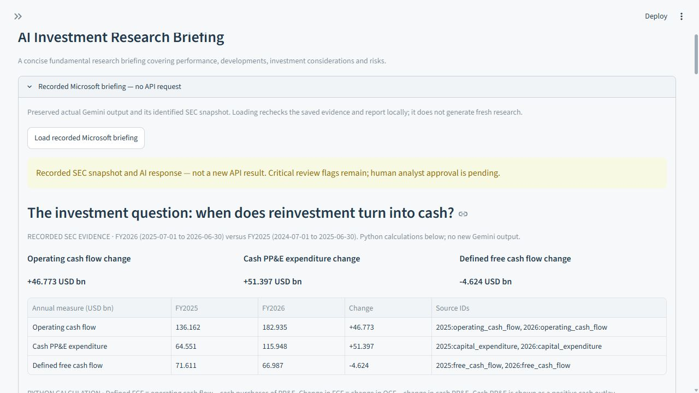
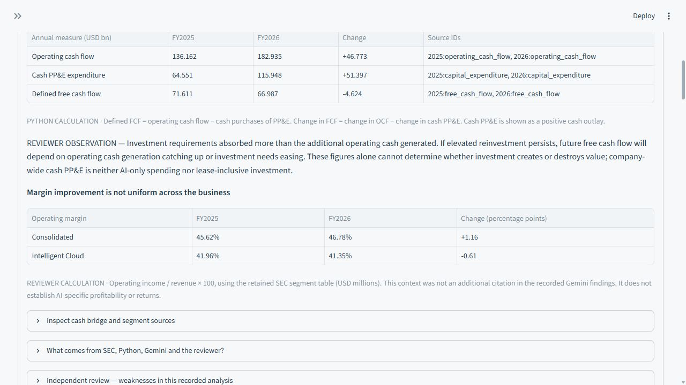
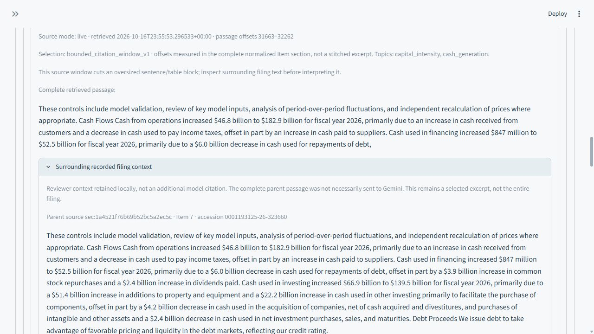
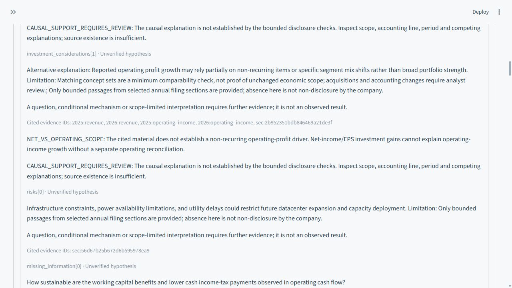

# AlphaLens

### AI-Assisted Fundamental Equity Research

I built AlphaLens as an independent project alongside my MPhil in Finance at the University of Cambridge. Equity research involves collecting disclosures, reconciling figures and deciding which changes matter economically. This project explores how Python and generative AI can assist that preparation while keeping evidence traceable and investment judgement with the analyst.



Python calculates the financial metrics. An optional language model interprets selected evidence. The genuine recorded demonstration works without an API key or a fresh model request.

Screenshots are genuine 20 and 21 October 2026 captures, checked against the current recorded workflow. [Capture provenance](docs/assets/README.md).

[Two-minute demonstration](docs/V1_1_DEMONSTRATION.md) · [Research evaluation](ALPHALENS_V1_1_EVALUATION.md) · [Code and methodology](EXPLAIN_THE_CODE.md)

## Microsoft: cash generation versus reinvestment

**Why did cash retained after investment decline while operating cash generation increased?**

The recorded comparison covers FY2025, 1 July 2024 to 30 June 2025, and FY2026, 1 July 2025 to 30 June 2026. Amounts are USD billions.

| Measure | FY2025 | FY2026 | Change |
|---|---:|---:|---:|
| Operating cash flow | 136.162 | 182.935 | +46.773 |
| Cash purchases of property, plant and equipment | 64.551 | 115.948 | +51.397 |
| Defined free cash flow | 71.611 | 66.987 | -4.624 |

**FCF = operating cash flow minus positive cash PP&E expenditure.** The bridge reconciles: `46.773 - 51.397 = -4.624`.

More cash was generated, but still more was absorbed by cash investment. That makes the duration of reinvestment and subsequent cash productivity important diligence questions. The figures establish neither attractive nor inadequate investment returns. Company-wide cash PP&E is not AI-specific spending or a lease-inclusive investment measure.

Consolidated operating margin improved from **45.62% to 46.78%**, while the retained Intelligent Cloud table implies a decline from **41.96% to 41.35%**. This reviewer calculation supplies contrary context, not a proven explanation.

Source: [Microsoft FY2026 SEC 10-K](https://www.sec.gov/Archives/edgar/data/789019/000119312526323660/msft-20260630.htm), accession `0001193125-26-323660`, filed 29 July 2026. The [source catalogue](outputs/msft_findings_live_2026-10-18/SOURCE_CATALOG.json) retains concepts, amounts, periods and filings. These are historical accounting records, not live market data.



## Visa: growth with margin contraction

The same deterministic pipeline was checked against genuine Visa SEC data. FY2024 runs from 1 October 2023 to 30 September 2024; FY2025 runs from 1 October 2024 to 30 September 2025.

| Measure | FY2024 | FY2025 | Change |
|---|---:|---:|---:|
| Revenue, USD billions | 35.926 | 40.000 | +11.34% |
| Operating income, USD billions | 23.595 | 23.994 | +1.69% |
| Operating margin | 65.68% | 59.98% | -5.692 percentage points |
| PP&E-defined free cash flow | N/A | N/A | Not calculated |

Revenue growth did not translate into comparable operating-profit growth. The filing identifies litigation provisions and personnel costs in its GAAP expense explanation. Cash-tax payment timing also matters when assessing operating cash growth. Recurrence and normalization need further analysis; a litigation accrual is not the same as escrow cash funding.

Visa's broader productive-assets tag includes software and intangible assets. It is not substituted for cash PP&E, so the existing FCF definition remains **N/A**. This different pattern tests generalisation without imposing Microsoft's reinvestment narrative on Visa.

Source: [Visa FY2025 SEC 10-K](https://www.sec.gov/Archives/edgar/data/1403161/000140316125000089/v-20250930.htm), accession `0001403161-25-000089`, filed 6 November 2025. [Evidence report](outputs/v1_1_2026-10-21/visa/VISA_EVIDENCE_REPORT.md). Visa is a standalone deterministic validation case; dashboard coverage remains MSFT, AAPL and AMZN.

## How it works

1. **Retrieve disclosures.** Resolve ticker to CIK and obtain official SEC facts and identified filing text, using an identified User-Agent, local caching and conservative request spacing.
2. **Reconcile periods.** Select comparable completed annual 10-K periods, distinguish durations from year-end balances, and retain concepts, units and filing provenance. Unreliable inputs remain N/A.
3. **Calculate and screen.** Python calculates growth, margins, defined FCF and cash-conversion relationships. Materiality rules identify questions to investigate, not investment conclusions.
4. **Interpret evidence.** Optional Gemini analysis receives source-bound observations and filing excerpts. It supplies qualitative interpretations, alternatives, risks and questions, not financial calculations.
5. **Check and review.** Pydantic validates structure. Local rules check figures, periods, citations and quotations, then flag selected accounting-attribution errors. An analyst still assesses economic meaning and causality.



## What the AI evaluation revealed

The genuine Microsoft briefing passed financial and source checks, yet a question presumed working-capital benefits that its disclosure did not establish. An operating-profit alternative also lacked suitable support: nearby investment gains concerned net income.

V1.1 preserves the original words and displays separate qualifications. A valid citation is not proof that a source supports a claim. The newer Python/reviewer framework adds competing mechanisms and evidence conditions; it is not presented as newly generated Gemini analysis.



The [independent Microsoft assessment](outputs/v1_1_2026-10-21/MICROSOFT_REVIEW.md) includes exact problematic passages and a scoring rubric. Its scores are AI-assisted reviewer judgments, not automated accuracy measurements or external investment approval.

## Technical implementation

Python 3.12+, Streamlit, Pandas, Plotly, Requests, BeautifulSoup, the OpenAI Python SDK and Pydantic. Gemini uses the existing provider adapter; optional OpenAI support remains separate. No vector database or agent framework is required.

| Modules in [alphalens/](alphalens/) | Responsibility |
|---|---|
| `sec.py`, `service.py` | SEC retrieval, cache, issuer resolution and orchestration |
| `financials.py`, `analytics.py` | Annual fact selection, calculations and pattern screening |
| `filings.py`, `retrieval.py`, `evidence.py` | Filing passages and issuer-bound evidence |
| `focused_briefing.py`, `providers.py` | Model context, optional inference and assembly |
| `research.py`, `research_integrity.py`, `analytical_review.py` | Structural, financial, provenance and bounded analytical checks |
| `saved_research.py`, `research_exports.py` | Recorded replay and source-linked exports |

[EXPLAIN_THE_CODE.md](EXPLAIN_THE_CODE.md) traces the actual functions and accounting choices. Development used AI coding assistance; the project is intended to be understood and critically reviewed, not presented as unaided authorship.

## Reproducibility

The repository is private, so cloning requires authorised GitHub access. From Windows PowerShell with Python 3.12 installed:

```powershell
git clone https://github.com/thoisyjerem/alphalens-equity-research.git
cd alphalens-equity-research
py -3.12 -m venv .venv
.\.venv\Scripts\python.exe -m pip install -r requirements.lock.txt
Copy-Item .env.example .env
.\.venv\Scripts\python.exe -m streamlit run app.py --server.address 127.0.0.1
```

Open `http://127.0.0.1:8501/`:

1. Choose **MSFT**, **Offline SEC fixture**, then **Load annual research**.
2. Open **AI Research Briefing**, expand the recorded Microsoft panel and load the recording.
3. Inspect the cash bridge, sources, **Investment reasoning** and **Analytical evidence review**.
4. Enable **Prepare downloadable AI research report** to export the note and audit JSON. Leave live-generation consent unchecked.

The installed offline demonstration needs no API key or internet. Initial installation needs internet. For live SEC retrieval, configure a legitimate `SEC_USER_AGENT` locally. New AI inference requires the selected provider's credentials in `.env` and explicit interface consent. Never commit credentials. Free quota and billing status depend on the provider project; AlphaLens cannot infer them from a key.

Replay Visa without network access:

```powershell
.\.venv\Scripts\python.exe scripts/validate_visa.py --replay
```

## Verification

The full suite passed **942 tests** in the working project (105.76 seconds) and again in the clean publication copy (146.56 seconds). Both runs had zero failures, errors or skips. [Execution records and limitations](EVALUATION.md). Run the complete suite:

```powershell
.\test.ps1
```

Tests cover annual period/concept selection, duplicate and missing facts, financial identities, API failures, incorrect figures, fabricated citations, model parsing, accounting-attribution errors, recorded replay and Streamlit exports. Authored test responses are labelled simulated and are not company research results.

Passing tests establish specified engineering controls, not the correctness of every investment explanation, repeated model quality or investment performance.

## Limitations

- The genuine Microsoft recording is dated and predates later prompt changes. The latest revised-prompt request returned HTTP 503 without a report; that prompt remains live-unverified.
- Analytical checks cover selected accounting errors and language patterns, not general semantic truth or economic causality.
- Annual data and bounded excerpts do not fully normalize working capital, cash taxes, leases, commitments or segment economics. Missing data is disclosed rather than estimated.
- Visa has important N/A values and no live AI analysis. It is not additional dashboard coverage.
- Challenge the Thesis is implemented and mock-tested; successful live research-quality evaluation remains unverified. Optional OpenAI live integration remains unverified.
- No market-price feed, consensus forecast, target price, rating, valuation model or AI-specific ROIC is provided.

This is an independent educational portfolio project, not a commercial service, JHI product or professional investment recommendation. A supervised demonstration is appropriate; an investment decision requires further evidence and analyst judgement.
